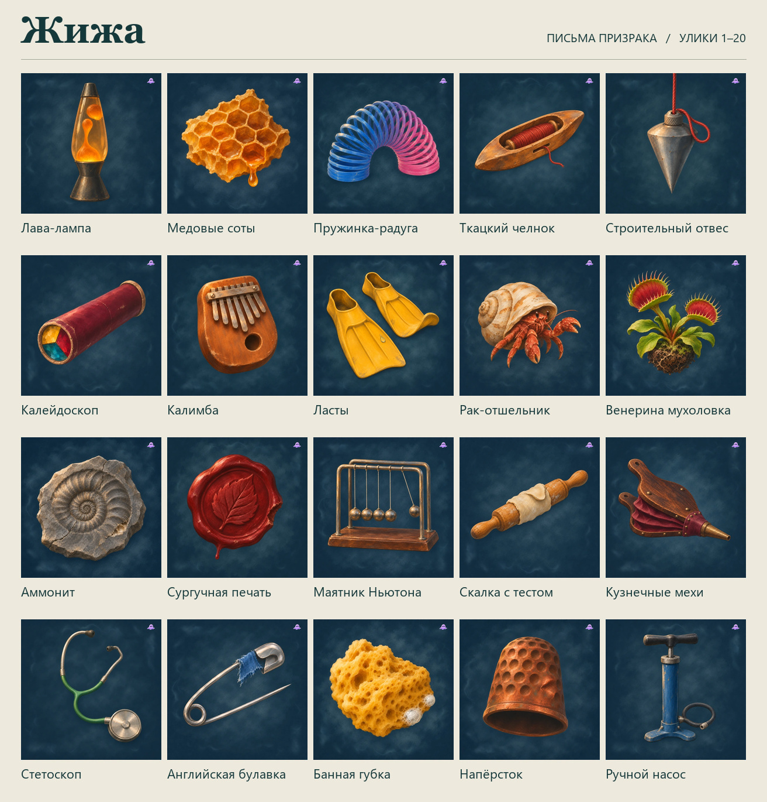
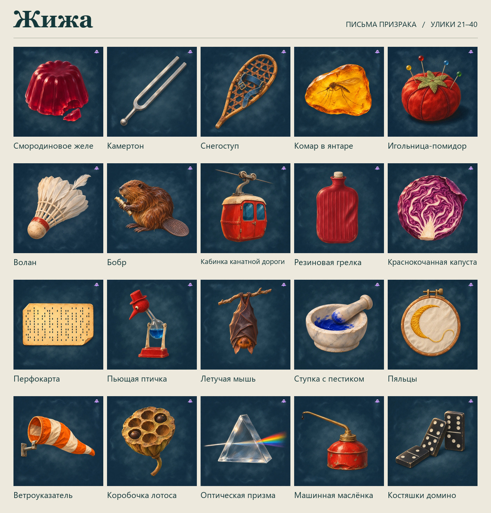
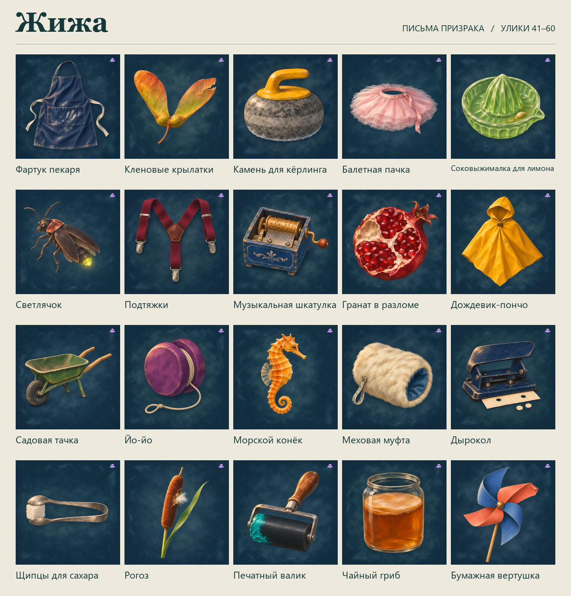
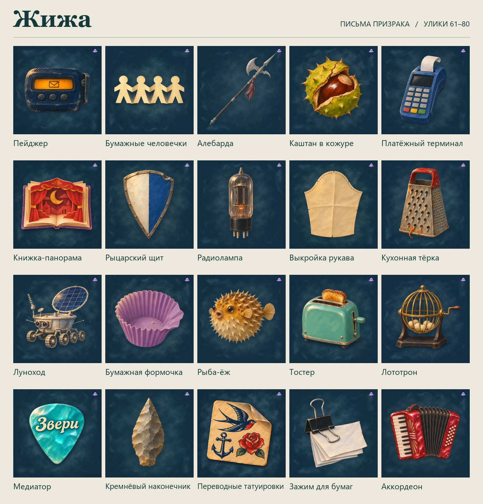
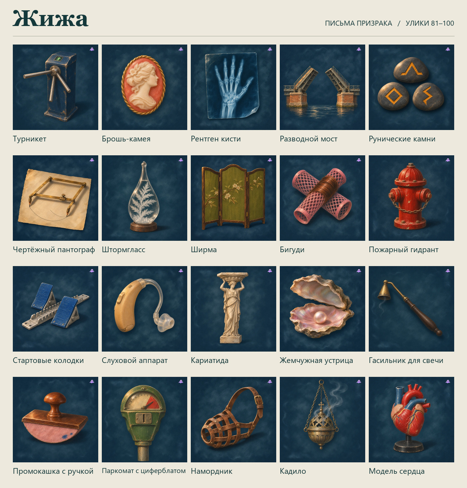
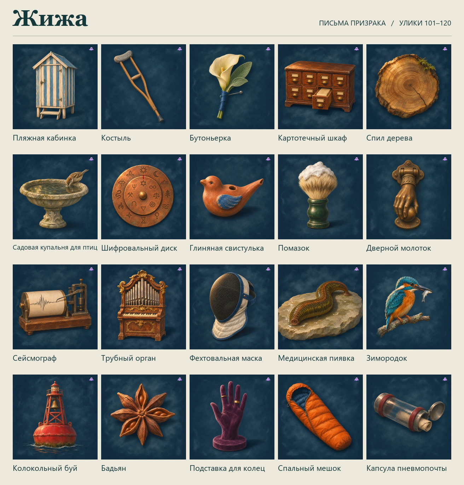
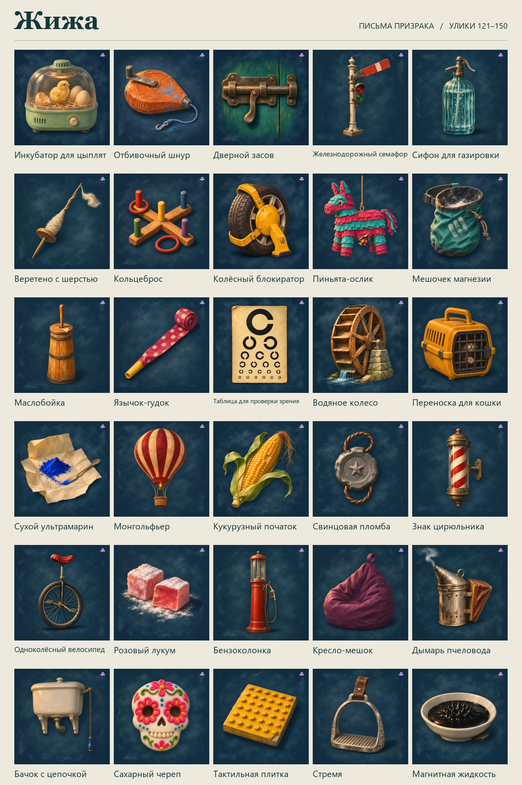
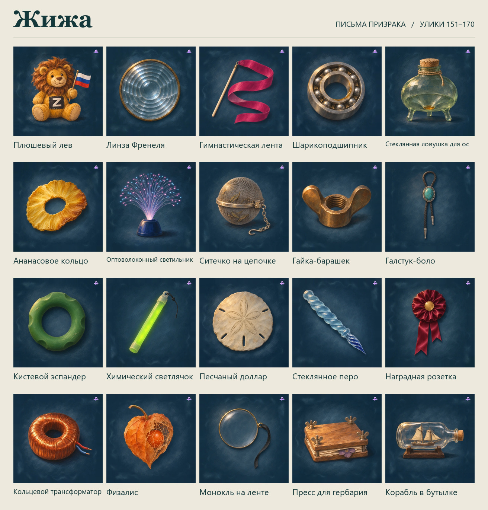
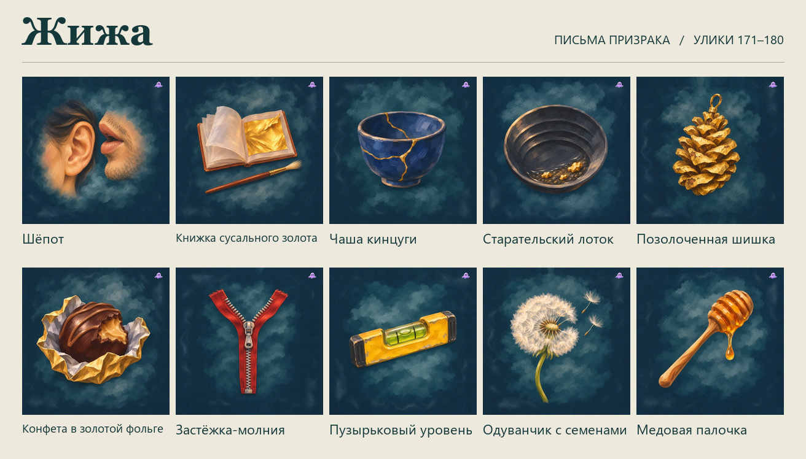

# «Жижа» — 200 карт

Финальный выпуск. [Общий лист JPG](zhizha-all-200.jpg) · [Одностраничный PDF](zhizha-all-200.pdf) · [HTML](zhizha-all-200.html) · [Все 200 карт](zhizha-cards-01-200.zip) · [Каталог](zhizha-final-200.json).

[Лицевые стороны для печати](zhizha-print-200.pdf) — 200 страниц по 69 × 69 мм, обрез 63 × 63 мм, вылет по 3 мм. Изображения RGB, 815 × 815 пикселей. Для карт 181–200 добавлены детали совпадающих крупных оригиналов. Основой первых 180 служат утверждённые карты 512 × 512.

## История выпуска первых 180 карт

В игру скопированы финальные изображения со значком и дымкой, названия, теги и ассоциации. Для обновления игровых копий из этого каталога используйте `python tools/cards/install_zhizha.py`. Серверная миграция `20261120133900_ZhizhaCardSet` регистрирует набор; стандартный импорт манифеста добавляет его карты. Сохранённый выбор наборов в существующих настройках не меняется.

[Карты 1–20](zhizha-cards.zip) · [Карты 21–40](zhizha-cards-21-40.zip) · [Карты 41–60](zhizha-cards-41-60.zip) · [Карты 61–80](zhizha-cards-61-80.zip) · [Карты 81–120](zhizha-cards-81-120.zip) · [Карты 121–150](zhizha-cards-121-150.zip) · [Карты 151–170](zhizha-cards-151-170.zip) · [Карты 171–180](zhizha-cards-171-180.zip) · [Все 180 карт](zhizha-cards-01-180.zip)

[Карты 1–180 одним изображением](zhizha-all-180.jpg) · [Пример значка на карте](zhizha-badge-example.jpg) · [Значок набора PNG](zhizha-set-icon.png)



















## Визуальный стиль

На всех 180 картах в правом верхнем углу размещён сиреневый призрак-лужица — выбранный значок № 4. Размер значка 28 × 20 пикселей, отступы: 24 справа и 18 сверху. По свободным тёмным краям добавлена лёгкая холодная дымка. Масштаб предметов сохранён; центральная область 368 × 368 пикселей не изменена. Финальные WebP сохранены без потерь.

Квадрат 512 × 512. Предмет или связанная группа расположены по центру. По сравнению с первым выпуском линейный размер иллюстрации уменьшен примерно на 12%. Фон тёмный серо-синий с мягкой живописной дымкой за предметом и спокойными полями. На самом предмете сохранены тёплый направленный свет и фактура гуаши.

Иллюстрации и их финальное оформление подготовлены с помощью ImageGen. В качестве цветовых ориентиров использованы карты с духами и коньком из обычных наборов. [Сравнить оформление на двух картах](zhizha-framing-comparison.jpg).

Опора — просмотр 761 локальной карты наборов «Оригинальный», «Почтовый ящик», «Тайный ритуал» и «Зеркало истины». Кастомных наборов в локальном манифесте нет; серверные пользовательские наборы не использованы.

Для карт 171–180 фон взят непосредственно с оригинальных духов (orig_0033) как цветовой и живописный образец: тёмные сине-бирюзовые края и холодная неровная дымка. Масштаб проверен при экспорте; все концы предметов помещаются в кадр.

## Темы и самостоятельная игра

Сравнение охватывает все 761 карту четырёх обычных наборов проекта. В таблице карта учитывается один раз в каждой теме, если у неё есть хотя бы один из соответствующих основных тегов. Например, к городской теме отнесены улица, здание и архитектура. Вторичные ассоциации в подсчёт тем не входят.

| Тема | Обычные наборы, 761 карта | Первые 170 | Все 180 |
| --- | ---: | ---: | ---: |
| Город и архитектура | 23 | 12 | 12 |
| Дом, мебель и ночлег | 31 | 7 | 7 |
| Украшения и мода | 67 | 7 | 8 |
| Тело и медицина | 100 | 13 | 14 |
| Вера, магия и обряды | 32 | 4 | 4 |
| Время, письмо и запись | 43 | 6 | 6 |
| Уход за собой и запахи | 38 | 7 | 7 |
| Охрана и спасение | 12 | 11 | 11 |
| Кухня и еда | 73 | 19 | 21 |
| Природа и животные | 77 | 32 | 34 |
| Спорт и соревнования | 22 | 12 | 12 |
| Ферма | 9 | 5 | 5 |
| Замки и запирание | 10 | 3 | 3 |
| Порошки | 6 | 4 | 4 |
| Знаки и вывески | 15 | 4 | 4 |
| Энергия и топливо | 25 | 3 | 3 |
| Праздники | 6 | 3 | 3 |
| Зрение и осязание | 20 | 3 | 3 |

Формы дают самостоятельные подсказки. У шарикоподшипника, сушёного ананаса, кистевого эспандера и трансформатора виден сквозной центр. Гимнастическая лента, цепочка чайного ситечка, концы боло и хвосты наградной розетки дают разные варианты подсказки «свисает». Для каждой новой карты в каталоге приведены ещё два письма из самой колоды.

Для каждой колоды разыграно 20 000 раскладов по прежней методике: пять улик и пять карт в руке. Доля рук с хотя бы одной строго различающей подсказкой: первые 170 — 62,0%, все 180 — 62,1%; обычные наборы — 59,6%–60,7%. Это проверка разметки, а не замена игровому тестированию.

## Состав

| № | Карта | Что изображено | Возможные связи с действующим каталогом |
| --- | --- | --- | --- |
| 1 | **Лава-лампа** | Высокая стеклянная лампа: внутри два янтарных восковых пузыря, один вытянулся каплей. Тёмное металлическое основание, мягкое внутреннее свечение. | фонарь (`orig_0040`); бутылка (`orig_0755`); фонарь (`orig_0184`) |
| 2 | **Медовые соты** | Неровный янтарный кусок сот. Из одной ячейки тянется короткая густая капля; никаких пчёл или банки. | варенье (`orig_0717`); жвачка (`orig_0110`); нуга (`orig_0610`) |
| 3 | **Пружинка-радуга** | Игрушечная пружина из цветного пластика, перекинутая дугой; основная масса синяя, второй конец розовый. | фотоплёнка (`orig_0197`); игрушка для взрослых (`orig_0295`); игрушка для взрослых (`orig_0313`) |
| 4 | **Ткацкий челнок** | Потёртый деревянный челнок-лодочка с красной катушкой внутри. Из прорези выходит короткая нить. | крючок (`orig_0009`); волынка (`orig_0498`); магнит (`orig_0571`) |
| 5 | **Строительный отвес** | Тяжёлый стальной конус на прямом красном шнуре, рядом короткая свободная петля того же шнура. Без шкалы. | ключи (`orig_0137`); перочинный нож (`orig_0233`); кинжал (`orig_0401`) |
| 6 | **Калейдоскоп** | Бордовая картонная трубка, на ближнем торце виден узор из трёх крупных разноцветных осколков. Никакого отдельного узора вокруг предмета. | подзорная труба (`orig_0201`); волчок (`orig_0496`); свиток (`orig_0634`) |
| 7 | **Калимба** | Небольшой деревянный резонатор с семью металлическими язычками; круглое отверстие чуть смещено, как удивлённый рот, без нарисованного лица. | микрофон (`orig_0068`); микрофоны (`orig_0223`); мегафон (`orig_0594`) |
| 8 | **Ласты** | Две жёлтые резиновые ласты разной ориентации; у одной кончик загнулся, на другой одна капля воды. | перчатки (`orig_0094`); уточка (`orig_0134`); перчатка (`orig_0056`) |
| 9 | **Рак-отшельник** | Небольшой красный рак выглядывает из обычной кремовой спиральной раковины; одна клешня слегка приподнята. | морская звезда (`orig_0003`); коралл (`orig_0687`); медуза (`orig_0014`) |
| 10 | **Венерина мухоловка** | Одна розетка хищного растения с двумя открытыми зелёными ловушками и красной внутренней поверхностью. Небольшой ком земли, без горшка и насекомых. | листья (`orig_0303`); клевер (`orig_0569`); бамбук (`orig_0741`) |
| 11 | **Аммонит** | Расколотая серая каменная плитка с отчётливой спиралью окаменелого аммонита. Крошечный скол открывает светлые камеры. | скульптура (`orig_0047`); пещера (`orig_0053`); водопад (`orig_0332`) |
| 12 | **Сургучная печать** | Отдельная тёмно-красная восковая печать с крупным простым отпечатком листа. Отбитый край и тонкий хвостик застывшей капли; без конверта и ручки штампа. | табличка (`orig_0316`); вывеска (`orig_0034`); табличка (`orig_0160`) |
| 13 | **Маятник Ньютона** | Настольная рамка с пятью стальными шарами на нитях. Крайний шар отведён в сторону; остальные выстроены в линию. | ноутбук (`orig_0150`); жёсткий диск (`orig_0302`); кастет (`orig_0576`) |
| 14 | **Скалка с тестом** | Деревянная скалка, к середине которой прилип короткий белый лоскут теста. Небольшая складка теста напоминает загнувшийся язычок. | кухонная утварь (`orig_0329`); перечница (`orig_0684`); крышка (`orig_0393`) |
| 15 | **Кузнечные мехи** | Небольшие ручные мехи из тёмного дерева и бордовой кожи; складчатый корпус наполовину раскрыт, металлический носик. Без огня рядом. | сумка (`orig_0399`); коляска (`orig_0517`); матрёшка (`orig_0107`) |
| 16 | **Стетоскоп** | Две металлические ушные дужки сходятся в зелёной Y-образной развилке. От неё одна изогнутая трубка идёт прямо к серебристой мембране. | секатор (orig_0657), перчатки (orig_0094), вставная челюсть (orig_0499) |
| 17 | **Английская булавка** | Крупная раскрытая серебристая булавка с маленьким лоскутом синей ткани на тупой стороне. Кончик свободен и хорошо виден. | пуговица (`orig_0616`); перочинный нож (`orig_0233`); опасная бритва (`orig_0546`) |
| 18 | **Банная губка** | Жёлтая пористая морская губка неправильной формы, два белых пузыря пены у края. Без ванной, ведра и мыла. | облако (`orig_0580`); щётка (`orig_0196`); унитаз (`orig_0214`) |
| 19 | **Напёрсток** | Перевёрнутый медный напёрсток с крупными углублениями; небольшая вмятина сбоку, тёмное открытое дно видно под углом. | огнетушитель (`orig_0255`); клетка (`orig_0127`); бочка (`orig_0128`) |
| 20 | **Ручной насос** | Синий напольный ручной насос с Т-образной чёрной ручкой и коротким гибким шлангом, свёрнутым одним кольцом. Без колеса. | ножовка (`orig_0138`); катана (`orig_0011`); ключ от машины (`orig_0264`) |
| 21 | **Смородиновое желе** | Рифлёный тёмно-малиновый купол желе, внизу от края отломилась маленькая дрожащая долька. Рубиновый полупрозрачный срез, без тарелки и ягод. | сахарная вата (orig_0070), пончик (orig_0278), кулич (orig_0443) |
| 22 | **Камертон** | Простой стальной камертон, две длинные одинаковые параллельные ветви, плавная U-образная развилка и одна короткая ручка с шариком. Диагональная композиция. | штангенциркуль (orig_0479), ключи (orig_0137), кинжал (orig_0401) |
| 23 | **Снегоступ** | Один старинный снегоступ формы вытянутой капли, гнутая деревянная рама и сетка из кожаных ремешков, синий ремень для стопы с металлической пряжкой. | конёк (orig_0022), кеды (orig_0431), бумеранг (orig_0287) |
| 24 | **Комар в янтаре** | Плоский медовый кусочек полупрозрачного янтаря, внутри в профиль навсегда застыл единственный тёмный длинноногий комар. Никакой оправы. | плитка (orig_0644), кристаллы (orig_0385), камень (orig_0441) |
| 25 | **Игольница-помидор** | Красная бархатная игольница стянута нитками в дольки. На макушке пришита зелёная фетровая звёздочка, из ткани торчат четыре булавки с разноцветными стеклянными головками. | клубок (orig_0724), швейная машинка (orig_0598), водолазный шлем (orig_0218) |
| 26 | **Волан** | Один бадминтонный волан по диагонали: белая коническая юбка из перекрывающихся перьев, красное кольцо у округлой пробковой головки. Одно перо выбилось из ровного венчика. | волчок (orig_0496), боулинг (orig_0339), бумажный самолётик (orig_0102) |
| 27 | **Бобр** | Коренастый мокрый бобр в профиль. Держит передними лапами короткую светлую ветку с парой следов зубов, широкий плоский чешуйчатый хвост виден целиком. | паук (orig_0076), конь (orig_0238), бабочка (orig_0190) |
| 28 | **Кабинка канатной дороги** | Красная закрытая кабинка подвесной канатной дороги в три четверти, кремовая крыша, синие окна и изогнутый металлический подвес с роликами на коротком отрезке троса. Без пейзажа и людей. | волга (orig_0328), фургон (orig_0311), мотоцикл (orig_0198) |
| 29 | **Резиновая грелка** | Плоская вишнёвая резиновая грелка с округлыми плечиками и небольшим светлым винтовым колпачком. На боку заметны вертикальные рёбра и мягкая вмятина. | кастрюля (orig_0681), самовар (orig_0450), уточка (orig_0134) |
| 30 | **Краснокочанная капуста** | Половина кочана фиолетовой капусты, срез обращён к зрителю: витки белых прожилок похожи на лабиринт. | апельсин (orig_0341), грецкий орех (orig_0444), апельсин (orig_0679) |
| 31 | **Перфокарта** | Старая прямоугольная кремовая картонная перфокарта с одним срезанным углом. Сетка мелких прямоугольных пробитых отверстий группируется в столбцы, нижний угол загнулся. Чистая бумага без букв и цифр. | портрет (orig_0119), витрувианский человек (orig_0265), папка (orig_0187) |
| 32 | **Пьющая птичка** | Классическая физическая игрушка drinking bird в простом профильном силуэте: красная войлочная голова с длинным клювом наклонена вперёд; стеклянная трубка-шея, прозрачная пузатая колба с синей жидкостью, две узкие опорные стойки на основании. Без стакана. | уточка (orig_0134), медуза (orig_0014), бокал вина (orig_0275) |
| 33 | **Летучая мышь** | Одна небольшая летучая мышь висит вниз головой на короткой веточке. Сложила тёмные перепончатые крылья вокруг тела как плащ, из-под них выглядывают рыжеватая мордочка и два уха. | ворон (orig_0058), ворон (orig_0065), сова (orig_0335) |
| 34 | **Ступка с пестиком** | Низкая белая мраморная ступка, тяжёлый пестик лежит на бортике. Внутри немного густой ультрамариновой краски, синий след остаётся на округлом конце пестика. | камин (orig_0442), пещера (orig_0053), кристаллы (orig_0385) |
| 35 | **Пяльцы** | Круглые деревянные пяльцы с молочно-белой тканью, на которой жёлтой нитью наполовину вышит полумесяц. Осталась одна длинная свободная ниточка, виден винт зажима. | кисти (orig_0018), бубен (orig_0409), крючок (orig_0009) |
| 36 | **Ветроуказатель** | Оранжево-белый полосатый аэродромный ветроуказатель на коротком металлическом кронштейне. Толстое круглое горло открыто, сужающийся тканевый рукав надулся вбок и изгибается. | палатка (orig_0078), кондитерский мешок (orig_0310), цирк (orig_0066) |
| 37 | **Коробочка лотоса** | Одна высохшая оливково-коричневая семенная коробочка лотоса на коротком выгнутом стебле. Плоский круглый верх с семью крупными гнёздами, два блестящих тёмных семени ещё внутри. | кактус (orig_0123), кактус (orig_0333), сухоцветы (orig_0493) |
| 38 | **Оптическая призма** | Один бесцветный треугольный оптический клин из полированного стекла. Узкий белый луч входит с одной стороны, короткий веер спектральных полос выходит с другой; сам клин крупнее лучей. | дверной глазок (orig_0381), диско шар (orig_0314), градусник (orig_0461) |
| 39 | **Машинная маслёнка** | Невысокая красная металлическая маслёнка слесаря, округлый жестяной корпус с продавленным донышком, очень длинный тонкий латунный носик наклонён вбок. Одна тёмная капля на самом кончике, без ручки-дуги. | миска (orig_0215), подстаканник (orig_0609), краска (orig_0319) |
| 40 | **Костяшки домино** | Три чёрные костяшки домино с крупными белыми точками и тонкой поперечной чертой. Одна уже лежит, вторая наклонилась, третья ещё стоит, образуя начинающуюся цепочку падения. Только традиционные точки. | нарды (orig_0429), колонизаторы (orig_0621), конь (orig_0238) |
| 41 | **Фартук пекаря** | Индиговый полотняный фартук с одной шейной петлёй, белые завязки, на широком кармане пыльный отпечаток трёх пальцев в муке. Фартук один, расправлен как перед надеванием, без тела и вешалки. | платок (orig_0293), мундир (orig_0021), маска (orig_0272) |
| 42 | **Кленовые крылатки** | Одна парная крылатка клёна крупным планом: две тонкие рыжевато-зелёные полупрозрачные лопасти образуют букву V и соединены у двух округлых семян. Одно крыло надломлено у края. | дерево (orig_0334), сосна (orig_0682), листья (orig_0303) |
| 43 | **Камень для кёрлинга** | Приземистый круглый камень для кёрлинга из пятнистого серого гранита. Над верхушкой — толстая жёлтая изогнутая ручка; по нижнему ребру тонкий иней. | маяк (orig_0416), метеорит (orig_0216), скульптура (orig_0047) |
| 44 | **Балетная пачка** | Одна бледно-розовая классическая балетная юбка-пачка, вид сверху и сбоку. Пустое овальное отверстие пояса, плоский расходящийся круг из нескольких пушистых слоёв фатина. Одна лента свисает сбоку. Без лифа, ног или балерины. | платок (orig_0293), трусики (orig_0118), шапочка выпускника (orig_0476) |
| 45 | **Соковыжималка для лимона** | Круглая светло-зелёная прессованная стеклянная ручная соковыжималка: в центре выпуклый ребристый конус, вокруг кольцевой желоб, сбоку маленький носик. В желобе одна лимонная косточка и капля сока; фрукт не изображать. | колба (orig_0027), дверной глазок (orig_0381), перечница (orig_0684) |
| 46 | **Светлячок** | Один небольшой тёмный жук-светлячок крупно в ракурсе три четверти; коричнево-чёрные надкрылья слегка раскрыты, под ними выделяется светящийся лимонно-зелёный кончик брюшка. Тусклое свечение узко охватывает кончик. | муха (orig_0019), муха (orig_0539), бабочка (orig_0190) |
| 47 | **Подтяжки** | Бордовые эластичные подтяжки лежат в ясной Y-образной форме: две плечевые ленты сверху сходятся в кожаной нашивке, внизу одна лента. На каждом из трёх свободных концов серебристая прищепка. Без брюк и человека. | галстук (orig_0537), кеды (orig_0431), туфли (orig_0153) |
| 48 | **Музыкальная шкатулка** | Миниатюрная музыкальная шкатулка без крышки, в небольшом синем деревянном коробе видны латунный цилиндр с точками-штифтами и зубчатый металлический гребень. Сбоку выступает заводная ручка с деревянной бусиной. Крупный единый предмет. | граммофон (orig_0357), граммофон (orig_0085), пластинка (orig_0299) |
| 49 | **Гранат в разломе** | Одна половинка спелого граната, надломленная руками. Тёмно-бордовая корона чашелистиков сбоку, белые перегородки и гроздья рубиновых полупрозрачных зёрен смотрят на зрителя. Одно гнездо пустое. | апельсин (orig_0341), апельсин (orig_0679), яблоко (orig_0685) |
| 50 | **Дождевик-пончо** | Охристо-жёлтое непромокаемое пончо с пустым капюшоном и одной тёмной застёжкой у горла. Широкое цельное треугольное полотнище расправлено, на складке три дождевые капли. Без рукавов, тела, лица и вешалки. | трусики (orig_0118), водопад (orig_0332), шапочка выпускника (orig_0476) |
| 51 | **Садовая тачка** | Зелёная садовая тачка с пустым потёртым кузовом, одно чёрное колесо спереди, две деревянные рукоятки и две задние опоры. Немного подсохшей земли на ободе. Ракурс сбоку в три четверти. | тележка (orig_0481), дуршлаг (orig_0147), миска (orig_0215) |
| 52 | **Йо-йо** | Фиолетовое деревянное йо-йо: две круглые половинки, между ними намотана одна светлая нить. Свободный конец описывает дугу и заканчивается маленькой петлёй для пальца. Без надписей. | волчок (orig_0496), марионетка (orig_0164), буквы (orig_0124) |
| 53 | **Морской конёк** | Один маленький золотисто-оранжевый морской конёк в профиль, вертикально: длинное трубчатое рыльце, прозрачный спинной плавник и спирально закрученный хвост. Никаких растений вокруг. | морская звезда (orig_0003), коралл (orig_0687), карпы кои (orig_0745) |
| 54 | **Меховая муфта** | Одна кремово-белая цилиндрическая винтажная муфта для согревания обеих рук. Толстый мех снаружи, с одного видимого торца синяя тканевая подкладка и сквозное отверстие, сбоку короткая петля для запястья. Без пальцев, рукавов, рук или тела. | шапка (orig_0106), шуба (orig_0713), свитер (orig_0540) |
| 55 | **Дырокол** | Старый тёмно-синий настольный канцелярский дырокол на два отверстия, плоский откидной рычаг приподнят. Из-под него выглядывает край кремовой бумаги с двумя ровными круглыми отверстиями и рядом два бумажных кружка. | домкрат (orig_0231), обогреватель (orig_0170), стиральная машина (orig_0550) |
| 56 | **Щипцы для сахара** | Одна изогнутая U-образная пара небольших потускневших серебряных щипцов для сахара с ложечкообразными концами держит единственный белый неровный кубик рафинада. Вид сбоку, простая конструкция из одной пружинящей полосы. | весы (orig_0248), циркуль (orig_0731), серьги (orig_0512) |
| 57 | **Рогоз** | Один стебель рогоза с коричневым бархатистым цилиндрическим початком и узким зелёным листом. Бок созревшего початка лопнул, оттуда выступает небольшой клочок белого пуха с семенами. | листья (orig_0303), клевер (orig_0569), бамбук (orig_0741) |
| 58 | **Печатный валик** | Ручной валик гравёра: короткая деревянная ручка, П-образная стальная скоба и широкий гладкий цилиндр из чёрной резины, поворачивающийся на оси. С одного края к цилиндру прилипла густая бирюзовая типографская краска. Без листа и надписей. | печать (orig_0436), вантуз (orig_0764), кухонная утварь (orig_0329) |
| 59 | **Чайный гриб** | Открытая прозрачная цилиндрическая банка, наполненная янтарно-коричневым чаем. Прямо на поверхности плавает один отчётливый толстый кремовый слоистый диск чайного гриба, виден сквозь стекло; по краю диска три пузырька. Без этикетки, крышки и плесени. | бутылка (orig_0755), пробирка (orig_0465), варенье (orig_0717) |
| 60 | **Бумажная вертушка** | Одна бумажная вертушка на тонкой деревянной палочке, ровно четыре загнутые лопасти из синей и коралловой бумаги закреплены одной круглой латунной кнопкой. Вид в три четверти, один угол слегка помялся. | волчок (orig_0496), журавлик (orig_0606), воздушный змей (orig_0722) |
| 61 | **Пейджер** | Потёртый тёмно-синий поясной пейджер. Узкий янтарный экран с единственной пиктограммой конверта, три круглые кнопки в ряд и сбоку выступает клипса. | автомат (orig_0133), зарядка (orig_0274), телефон (orig_0723) |
| 62 | **Бумажные человечки** | Одна гармошка из вырезанной кремовой бумаги, развёрнутая в ряд из четырёх одинаковых человечков. Фигурки соединены ладонями, по сгибам чередуются свет и тень. | журавлик (orig_0606), бумажный самолётик (orig_0102), кораблик (orig_0474) |
| 63 | **Алебарда** | Старинная парадная алебарда, целиком по диагонали. Характерный силуэт полумесяца, клюва и острия на длинном тёмном древке. Под серебристым навершием выцветшая бордовая кисточка. Один музейный предмет. | ружьё (orig_0507), вилы (orig_0130), колья (orig_0359) |
| 64 | **Каштан в кожуре** | Один плод конского каштана в надтреснувшей зелёной оболочке с короткими шипами. Внутри выглядывает гладкий блестящий коричневый каштан со светлым пятном. | дерево (orig_0334), сосна (orig_0682), дерево в горшке (orig_0049) |
| 65 | **Платёжный терминал** | Синий переносной платёжный терминал с цифровой клавиатурой, маленьким тёмным экраном и тремя цветными клавишами. Из встроенной прорези сверху выходит короткий белый завиток чека. Без брендов и разборчивого текста. | шредер (orig_0696), детектор лжи (orig_0388), автомат (orig_0133) |
| 66 | **Книжка-панорама** | В раскрытой книге из бумажных страниц поднимается миниатюрная театральная сцена. Красные кулисы обрамляют золотой полумесяц над силуэтом города. | книги (orig_0052), книги (orig_0551), папка (orig_0187) |
| 67 | **Рыцарский щит** | Один старинный треугольный рыцарский щит: выгнутый верх, острый нижний угол, эмаль разделена на белую и синюю половины, на ободе заметная вмятина. Лицевая сторона без герба, букв или другого оружия. | люк (orig_0116), спутниковая тарелка (orig_0703), жетон (orig_0510) |
| 68 | **Радиолампа** | Одна винтажная электронная радиолампа. В прозрачном вытянутом стекле видны тёмные металлические пластины и маленький оранжевый накал, снизу чёрный цоколь с короткими контактными ножками. Никаких букв. | оптический прицел (orig_0347), телескоп (orig_0051), подзорная труба (orig_0201) |
| 69 | **Выкройка рукава** | Изогнутая портновская выкройка одного рукава из тонкой бежевой бумаги, слегка развёрнута после складывания. Штриховая линия шва повторяет дугу верхнего края, по краям маленькие насечки. Никаких букв, рулеток, ножниц. | карта (orig_0129), фотография (orig_0139), мона лиза (orig_0203) |
| 70 | **Кухонная тёрка** | Старая четырёхгранная металлическая кухонная тёрка с красной ручкой наверху. На соседних сторонах разный калибр рельефных отверстий, у нижнего края застряла тонкая морковная стружка. | набор инструментов (orig_0656), холодильник (orig_0555), обогреватель (orig_0170) |
| 71 | **Луноход** | У серебристого лунохода несколько пар колёс, два объектива и тонкая антенна. Над корпусом поднята круглая крышка с синей сеткой солнечной панели. | полицейская машина (orig_0762), ноутбук (orig_0150), холодильник (orig_0555) |
| 72 | **Бумажная формочка** | Одна пустая сиреневая бумажная формочка для кекса с веером вертикальных складок. С одного края несколько складок расправлены, внутри пара крошек. Никакого самого кекса. | чайный пакетик (orig_0556), молоко (orig_0457), стакан кофе (orig_0273) |
| 73 | **Рыба-ёж** | Одна круглая раздутая рыба-ёж в три четверти. Короткие светлые иглы торчат по всему жёлто-коричневому телу, заметны два крошечных плавника и округлый хвост. Без воды или кораллов вокруг. | ёжик (orig_0408), медуза (orig_0014), жаба (orig_0340) |
| 74 | **Тостер** | Небольшой бирюзовый винтажный электрический тостер со скруглённым эмалированным корпусом и боковым рычажком. Из одной из двух прорезей наполовину выскочил золотой тост. | аккумулятор (orig_0026), ноутбук (orig_0150), пауэрбанк (orig_0178) |
| 75 | **Лототрон** | Небольшой круглый лотерейный барабан из латунных прутьев на тёмной настольной подставке. В нижней части лежат несколько шариков цвета слоновой кости, ручка сбоку. На шарах нет текста. | звонок (orig_0433), волчок (orig_0496), баскетбольное кольцо (orig_0629) |
| 76 | **Медиатор** | На бирюзовом перламутровом медиаторе светлыми буквами напечатано название группы «Звери». Видны округлая треугольная форма и потёртый кончик. | табличка (orig_0103), фишки (orig_0125), пластинка (orig_0299) |
| 77 | **Кремнёвый наконечник** | Одиночная археологическая находка — небольшой серо-охристый кремнёвый наконечник листовидного силуэта, одна грань светлее другой. Просто музейный портрет предмета, без стрелы, людей, схем и подписей. | водопад (orig_0332), табличка (orig_0160), метеорит (orig_0216) |
| 78 | **Переводные татуировки** | На кремовой бумаге напечатаны синяя ласточка, якорь и красная роза. Угол прозрачной защитной плёнки отогнут и бликует над рисунками. | портрет (orig_0119), витрувианский человек (orig_0265), фотография (orig_0139) |
| 79 | **Зажим для бумаг** | Один чёрный стальной канцелярский зажим держит веер из нескольких белых листков за угол. Одна серебристая проволочная ручка поднята, вторая откинута на бумагу. | пуговица (orig_0616), прищепка (orig_0714), веер (orig_0742) |
| 80 | **Аккордеон** | Небольшой красный перламутровый аккордеон с белой фортепианной клавиатурой по правую руку исполнителя и светлыми басовыми кнопками напротив; чёрные складчатые мехи растянуты на несколько складок. Без рук, музыканта или букв. | виолончель (orig_0331), банджо (orig_0637), звонок (orig_0433) |

## Карты 81–120 и связи внутри «Жижи»

| № | Карта | Что изображено | Два письма из этого же набора |
| --- | --- | --- | --- |
| 81 | **Турникет** | Один потёртый проходной турникет на тумбе из тёмно-синей эмали. Три стальные перекладины расходятся от единой ступицы; сверху маленькая зелёная стрелка. Вид в три четверти. | Платёжный терминал — оплата проезда. Разводной мост — открывающийся проход. |
| 82 | **Брошь-камея** | Овальная кораллово-розовая камея в тонкой витой золотой оправе. Резной профиль женщины из сливочно-белого слоя выступает над розовым камнем. | Кариатида — резной женский профиль. Подставка для колец — ювелирная витрина. |
| 83 | **Рентген кисти** | Отдельный синий полупрозрачный рентгеновский снимок одной раскрытой человеческой кисти с пятью пальцами. Кости читаются белыми на тёмной плёнке, нижний угол слегка загнут. | Стетоскоп — обследование. Дверной молоток — та же человеческая кисть. |
| 84 | **Разводной мост** | Небольшой архитектурный этюд одного разводного моста. Два симметричных стальных пролёта подняты буквой V над узкой полоской воды, у основания два кирпичных устоя. Целиком, без города. | Бобр — преграда через реку. Кабинка канатной дороги — переправа над препятствием. |
| 85 | **Рунические камни** | Три гладкие тёмно-серые речные гальки треугольником. На каждой вырезан один отличный от двух других угловатый знак, заполненный охрой. | Костяшки домино — знаки на отдельных фишках. Кремнёвый наконечник — древний камень. |
| 86 | **Чертёжный пантограф** | Старинный чертёжный пантограф на плоском листе. Тонкие латунные шарнирные планки объединены в косой параллелограмм, два коротких карандашных наконечника касаются двух схожих дуг разного размера. | Выкройка рукава — перенос контура. Маятник Ньютона — подвижная геометрическая конструкция. |
| 87 | **Штормгласс** | Высокий запаянный прозрачный стеклянный сосуд каплевидной формы на маленькой круглой деревянной подставке. В прозрачной жидкости из белых кристаллов выросло подобие ветки папоротника. | Ветроуказатель — погода. Оптическая призма — прозрачное стекло. |
| 88 | **Ширма** | Отдельно стоящая трёхстворчатая ширма, две створки под углом. Тёмная деревянная рама, оливково-зелёная ткань, одна вытканная ветка переходит с панели на панель. | Выкройка рукава — переодевание. Книжка-панорама — створки на сгибах. |
| 89 | **Бигуди** | Две крупные розовые сетчатые бигуди лежат крест-накрест. На одну намотана короткая прядь каштановых волос, вторая полая, видно её сетку. | Пружинка-радуга — завиток. Помазок — уход за волосами. |
| 90 | **Пожарный гидрант** | Приземистый красный пожарный гидрант с куполообразной головкой, двумя боковыми крышками и короткой цепочкой. На эмали несколько светлых сколов. | Ручной насос — подача воды. Платёжный терминал — городское оборудование. |
| 91 | **Стартовые колодки** | Одна пара спортивных стартовых колодок. Две наклонные синие ребристые опоры смещены одна относительно другой на общей алюминиевой рейке. | Снегоступ — опора под ногой. Волан — спортивная площадка. |
| 92 | **Слуховой аппарат** | Один заушный слуховой аппарат. Бежевый корпус в форме запятой, от него изогнутая прозрачная трубочка ведёт к мягкому вкладышу. Вкладыш и корпус хорошо различимы. | Стетоскоп — выслушивание. Камертон — звук для проверки слуха. |
| 93 | **Кариатида** | Один светлый каменный архитектурный фрагмент. Женская фигура в длинном складчатом одеянии стоит на квадратном основании и поддерживает на голове тяжёлую плоскую капитель. | Брошь-камея — резная фигура. Разводной мост — несущая опора. |
| 94 | **Жемчужная устрица** | Две неровные створки открытой устрицы соединены сзади. В розовом перламутре нижней створки лежит одна круглая жемчужина. Вид под углом со стороны жемчужины. | Рак-отшельник — створка или раковина как дом. Брошь-камея — материал украшения. |
| 95 | **Гасильник для свечи** | Латунный гасильник на длинной тёмной деревянной ручке. Маленький латунный конус висит отверстием вниз; из закопчённого края выходит тонкий завиток дыма. | Кузнечные мехи — управление огнём. Кадило — дым и церемония. |
| 96 | **Промокашка с ручкой** | Одна настольная промокашка с грибовидной ручкой из полированного дерева. Покачивающееся полукруглое основание обтянуто розовой промокательной бумагой, у края два синих чернильных пятна. | Печатный валик — след чернил. Сургучная печать — письменный стол. |
| 97 | **Паркомат с циферблатом** | Головка старого зелёного парковочного счётчика на короткой части металлической стойки. За стеклом красный сектор и единственная стрелка, ниже явная монетная щель. | Платёжный терминал — оплата. Лототрон — старый счётный механизм. |
| 98 | **Намордник** | Один пустой коричневый плетёный кожаный намордник собаки. Корзинка из пересекающихся ремешков с круглым носом, за ней дугой поднят ремень с пряжкой. | Фехтовальная маска — защитная сетка перед лицом. Подтяжки — ремни с застёжкой. |
| 99 | **Кадило** | Бронзовое церковное кадило висит на трёх сходящихся цепочках. Сферическая чашечка с ажурной крышкой, через отверстия поднимается сероватый дым. | Гасильник для свечи — дым. Маятник Ньютона — качающийся подвес. |
| 100 | **Модель сердца** | Одна старая учебная анатомическая модель сердца на короткой чёрной подставке. Красная мышца, крупная синяя вена и красная дуга аорты. Чистый окрашенный учебный муляж из пластика. | Стетоскоп — сердцебиение. Сейсмограф — запись колебаний, похожая на пульс. |
| 101 | **Пляжная кабинка** | Одна закрытая деревянная пляжная кабинка на ножках со ступенькой. Белые и голубые вертикальные полосы, остроконечная крыша, на двери металлический крючок. | Ласты — пляж. Ширма — место для переодевания. |
| 102 | **Костыль** | Один деревянный подмышечный костыль целиком по небольшой диагонали. Раздвоенная рама с поперечной ручкой, серая мягкая опора наверху и резиновая насадка внизу. | Снегоступ — поддержка при ходьбе. Стартовые колодки — нагрузка на ноги. |
| 103 | **Бутоньерка** | Одна свадебная бутоньерка. Кремовая калла и два шалфейных листика собраны в маленький пучок, стебель обмотан синей лентой, сзади выступает булавка для лацкана. | Английская булавка — крепление к одежде. Фартук пекаря — деталь костюма. |
| 104 | **Картотечный шкаф** | Низкий старинный деревянный библиотечный шкаф с восемью маленькими выдвижными ящиками, латунными ручками и окошками для этикеток. Один ящик выдвинут, видны ряды кремовых карточек. | Перфокарта — карточка для хранения сведений. Зажим для бумаг — сортировка документов. |
| 105 | **Спил дерева** | Один неровный спил дерева с тёмным ободком коры и хорошо видимыми годичными кольцами. Радиальная трещина пересекает несколько колец, снаружи клочок зелёного мха. | Аммонит — след времени из природы. Каштан в кожуре — дерево. |
| 106 | **Садовая купальня для птиц** | Неглубокая каменная садовая чаша на одной невысокой резной ножке. В воде круги, на краю один маленький воробей наклонился к воде. | Зимородок — птица у воды. Ступка с пестиком — тяжёлая чаша. |
| 107 | **Шифровальный диск** | Два концентрических медных диска разного диаметра соединены центральной заклёпкой. На ободках два ряда выгравированных разных условных знаков и одна короткая красная отметка для совмещения. | Перфокарта — скрытое в знаках сообщение. Турникет — вращение вокруг общей оси. |
| 108 | **Глиняная свистулька** | Терракотовая свистулька в виде округлой птички с маленьким синим крылом. Полый хвост-мундштук заострён, сверху ясно видно круглое игровое отверстие. | Зимородок — силуэт птицы. Калимба — небольшой музыкальный инструмент. |
| 109 | **Помазок** | Один короткий бритвенный помазок. Густой округлый пучок светлого ворса на тёмно-зелёной точёной ручке, на кончиках шапочка белой мыльной пены. | Банная губка — мыльная пена. Меховая муфта — фактура мягкого ворса. |
| 110 | **Дверной молоток** | Один старинный бронзовый дверной молоток в виде кисти руки, сжимающей небольшой шар. Петля-шарнир у запястья, под костяшками видна овальная пластина для удара. | Камертон — звук после удара. Подставка для колец — предмет в форме руки. |
| 111 | **Сейсмограф** | Настольный механический сейсмограф. На светлом бумажном цилиндрическом барабане одна чёрная зигзагообразная линия, кончик длинного пера касается бумаги, деревянное основание. | Печатный валик — отпечаток на бумаге. Маятник Ньютона — колебания механизма. |
| 112 | **Трубный орган** | Небольшой цельный барочный орган с одним рядом клавиш в деревянном корпусе. Над клавиатурой поднимается веер серебряных органных труб разной высоты. Без фигуры органиста. | Аккордеон — клавиши и воздух. Кадило — церковная служба. |
| 113 | **Фехтовальная маска** | Пустая спортивная фехтовальная маска чуть повёрнута в три четверти. Лицо закрывает овальная тёмная мелкая сетка, внизу белая стёганая горловина, окантовка синяя. | Рыцарский щит — защита в поединке. Намордник — сетка перед лицом. |
| 114 | **Медицинская пиявка** | Одна оливково-коричневая медицинская пиявка изогнулась плавной буквой S на мокром плоском светлом камне. Низкий ракурс: поперечные кольца, рыжие полоски вдоль спины и маленькая присоска. | Стетоскоп — медицина. Рыба-ёж — водное животное. |
| 115 | **Зимородок** | Одна небольшая сине-бирюзовая птица с рыжей грудкой и длинным острым клювом сидит на короткой ветке. В клюве серебристая маленькая рыбка. | Рыба-ёж — добыча в воде. Глиняная свистулька — силуэт птицы. |
| 116 | **Колокольный буй** | Один морской навигационный буй. Красный поплавок с широким пузатым основанием, над ним открытая металлическая башенка с одним видимым бронзовым колоколом. У основания тонкая кромка волны. | Камертон — звуковой сигнал. Ветроуказатель — ориентир на открытом месте. |
| 117 | **Бадьян** | Один крупный плод бадьяна, вокруг центра расходятся восемь сухих лодочек-лучей. В нескольких раскрытых лучах блестят мелкие коричневые семена. | Краснокочанная капуста — еда растительного происхождения. Коробочка лотоса — семена в отдельных ячейках. |
| 118 | **Подставка для колец** | Тёмно-фиолетовая бархатная подставка в форме вертикальной ладони с пятью пальцами на круглом основании. На двух пальцах простые золотые кольца разной толщины. | Брошь-камея — украшение. Рентген кисти — пальцы ладони. |
| 119 | **Спальный мешок** | Один пустой оранжевый походный спальник-кокон лежит по диагонали. Капюшон раскрыт, из-под приоткрытой молнии видна синяя подкладка, поперечная стёжка образует мягкие валики. | Дождевик-пончо — снаряжение для похода. Резиновая грелка — согревание. |
| 120 | **Капсула пневмопочты** | Прозрачная цилиндрическая капсула с двумя тёмно-красными амортизирующими кольцами. Одна торцевая крышка откинута, изнутри чуть выступает свёрнутая бумажная записка. | Пейджер — передача сообщения. Кузнечные мехи — поток воздуха. |

## Карты 121–150 и связи внутри «Жижи»

| № | Карта | Что изображено | Два письма из этого же набора |
| --- | --- | --- | --- |
| 121 | **Инкубатор для цыплят** | Небольшой мятно-зелёный настольный инкубатор с прозрачным куполом. Под куполом на ячеистом лотке сидит пушистый жёлтый цыплёнок рядом с расколотой скорлупой и двумя целыми яйцами. На корпусе маленькая ручка термостата. | Зимородок даёт подсказку «птица», резиновая грелка — «тепло». (№ 115 и 29) |
| 122 | **Отбивочный шнур** | Потёртая оранжевая строительная отбивка с плоским корпусом, боковой откидной рукояткой и выглядывающим из носика синим меловым шнуром. Короткий свободный конец изогнут, на нём маленький крючок и следы синей пыли. | Мешочек магнезии подсказывает меловой порошок, чертёжный пантограф — проведение линий. (№ 130 и 86) |
| 123 | **Дверной засов** | Крупный старый стальной засов горизонтально на стыке двух небольших фрагментов бирюзовых досок. Изогнутая рукоятка опущена; конец задвижки вошёл в отдельную ответную скобу на второй доске. | Дверной молоток указывает на дверь, пляжная кабинка — на уединение за закрытой дверью. (№ 110 и 101) |
| 124 | **Железнодорожный семафор** | Один старинный железнодорожный семафор. Белая металлическая стойка на коротком основании, на шарнире поднято красное сигнальное крыло с белой полосой, под ним два цветных стекла. | Турникет связан со станцией, ветроуказатель подаёт знак положением своей подвижной части. (№ 81 и 36) |
| 125 | **Сифон для газировки** | Тяжёлый голубоватый стеклянный сифон с рифлёными стенками. На узкой горловине потемневшая головка с коротким боковым носиком и рычагом; в воде хорошо видны пузырьки. | Чайный гриб связывает улики через пузырьки в напитке, ручной насос — через давление. (№ 59 и 20) |
| 126 | **Веретено с шерстью** | Тонкое деревянное подвесное веретено с круглым пряслицем и намотанной кремовой пряжей. От острого конца тонкая скрученная нить переходит в маленькую прядь ещё рыхлой шерсти. | Ткацкий челнок подсказывает нить, меховая муфта — мягкое тёплое волокно. (№ 4 и 54) |
| 127 | **Кольцеброс** | Миниатюрный настольный кольцеброс. Из деревянного крестообразного основания торчат разноцветные короткие колышки; красное верёвочное кольцо на одном, другое лежит у основания. | Волан указывает на игру, где важна меткость, а лототрон — на ярмарочное развлечение. (№ 26 и 75) |
| 128 | **Колёсный блокиратор** | Автомобильное колесо в три четверти, на него надет широкий жёлтый металлический парковочный зажим. Его наружная лапа закрывает ступицу, две другие яркие лапы охватывают тёмную шину. Отдельный предмет на фоне. | Паркомат указывает на стоянку, намордник — на ограничивающий зажим. (№ 97 и 98) |
| 129 | **Пиньята-ослик** | Одна подвешенная за петельку пиньята в форме ослика, собранная из полос бахромчатой бумаги. Бирюзовые и малиновые полосы, маленький разрыв снизу, из него выглядывают две конфеты. | Бумажные человечки дают подсказку про бумажную поделку, формочка для кекса — про сладкое на празднике. (№ 62 и 72) |
| 130 | **Мешочек магнезии** | Открытый бирюзовый поясной мешочек скалолаза с коротким ремешком и шнуром-затяжкой. У горловины виден белый порошок, снаружи на ткани отпечатались три запылённых пальца. | Рентген кисти указывает на пальцы, стартовые колодки — на сцепление во время спортивного усилия. (№ 83 и 91) |
| 131 | **Маслобойка** | Высокая узкая деревянная маслобойка из клёпок с тёмными обручами. Через круглую крышку проходит вертикальная рукоять толкача; у отверстия мазок густых сливок. | Ступка с пестиком подсказывает обработку пищи толкачом, ручной насос — повторяющееся движение рукоятки. (№ 34 и 20) |
| 132 | **Язычок-гудок** | Один праздничный язычок-гудок по диагонали. Короткий жёлтый мундштук переходит в длинную малиновую бумажную полоску в горошек, дальний конец закручен плотной спиралью. | Глиняная свистулька напоминает о звуке от выдоха, пружинка-радуга — о свёрнутом витке. (№ 108 и 3) |
| 133 | **Таблица для проверки зрения** | Одна плоская кремовая офтальмологическая таблица. Сверху одно крупное чёрное кольцо с разрывом. Ниже несколько рядов постепенно уменьшающихся колец, у каждого один разрыв, повёрнутый в свою сторону. Только кольца, без букв, цифр или подписей. | Слуховой аппарат указывает на проверку чувств, оптическая призма — на зрение. (№ 92 и 38) |
| 134 | **Водяное колесо** | Большое вертикальное деревянное мельничное колесо на короткой видимой оси и каменной опоре, без здания. По нижним лопастям проходит небольшая струя синей воды. | Разводной мост подсказывает сооружение на реке, аммонит — круглый ребристый контур. (№ 84 и 11) |
| 135 | **Переноска для кошки** | Закрытая пластиковая переноска тёплого горчичного цвета. Поднятая ручка и тёмная решётчатая дверца с боковой защёлкой; из-за решётки виден любопытный серый кошачий нос и лапа. | Намордник указывает на питомца за решёткой, кабинка канатной дороги — на перевозку в закрытой кабине. (№ 98 и 28) |
| 136 | **Сухой ультрамарин** | На развёрнутой кремовой бумажной аптечной капсуле лежит маленькая горка ярко-синего сухого пигмента. Из горки выскользнула узкая плоская лопаточка с синим кончиком, по бумаге тянется след пыли. | Печатный валик подсказывает красящий материал, ступка с пестиком — растирание в порошок. (№ 58 и 34) |
| 137 | **Монгольфьер** | Один целый тепловой аэростат в полёте. Каплевидная полосатая оболочка бордового и кремового цвета, под её горловиной маленькое оранжевое пламя горелки и одна плетёная корзинка на стропах. Без пейзажа. | Кабинка канатной дороги напоминает подвешенную корзину, гасильник для свечи — пламя. (№ 28 и 95) |
| 138 | **Кукурузный початок** | Один золотой початок с частично отогнутыми зелёными листьями. В плотных рядах зёрен виден небольшой пробел; с верхушки свисает пучок тонких кукурузных рылец. | Медовые соты подсказывают ровный повторяющийся узор, гранат в разломе — множество зёрен под оболочкой. (№ 2 и 49) |
| 139 | **Свинцовая пломба** | Крупно показана одна старая плоская круглая свинцовая пломба на замкнутой петле витой медной проволоки. На мягком сером металле рельефный оттиск маленькой звезды, без надписи. | Сургучная печать подсказывает оттиск, капсула пневмопочты — сохранность отправления. (№ 12 и 120) |
| 140 | **Знак цирюльника** | Отдельная винтажная вывеска цирюльника: вертикальный стеклянный цилиндр с широкой красно-белой винтовой полосой внутри. Металлические колпаки сверху и снизу, сбоку заметен короткий настенный кронштейн. | Помазок напоминает о бритье, бигуди — о парикмахерской. (№ 109 и 89) |
| 141 | **Одноколёсный велосипед** | Один цирковой одноколёсный велосипед целиком. Сверху маленькое красное седло на стойке, снизу одно большое чёрное колесо со спицами, две педали у ступицы. Руля нет. | Стартовые колодки напоминают опоры для ног спортсмена, аммонит — контур колеса и линии, расходящиеся от центра. (№ 91 и 11) |
| 142 | **Розовый лукум** | Два небольших кубика розового лукума; один разрезан, на срезе видно полупрозрачное розовое желе. Верхние грани припудрены сахарной пудрой, на поверхности под кубиками белая россыпь. | Смородиновое желе подсказывает прозрачную мягкую серединку, щипцы для сахара — белый сахарный кубик. (№ 21 и 56) |
| 143 | **Бензоколонка** | Одна винтажная красная бензоколонка с высоким прозрачным мерным цилиндром наверху. С бокового крючка спускается чёрный шланг с металлическим заправочным пистолетом. Без марок и цифр. | Машинная маслёнка указывает на жидкость для машины, пожарный гидрант — на красное оборудование для подачи жидкости. (№ 39 и 90) |
| 144 | **Кресло-мешок** | Одно мягкое сливово-фиолетовое кресло-груша с низкой вмятиной для сидения, петелькой на верхушке и крепким боковым швом. Мягкий свет подчёркивает складки плотной ткани. | Спальный мешок напоминает мягкий тканевый кокон, меховая муфта — уютную складку. (№ 119 и 54) |
| 145 | **Дымарь пчеловода** | Один пасечный дымарь. Закопчённый цилиндр из серебристого металла с конусообразным носиком, сбоку прикреплены небольшие кожаные мехи, сверху выходит тонкая белая струйка прохладного дыма. | Кузнечные мехи указывают на поток воздуха, медовые соты — на пасеку. (№ 15 и 2) |
| 146 | **Бачок с цепочкой** | Старинный белый керамический бачок с закруглённым передним краем на двух кронштейнах. Из дна вниз уходит короткая изогнутая сливная труба, справа свободно свисает длинная цепочка с синей ручкой. | Кадило подсказывает подвесную цепочку, пожарный гидрант — выпуск воды. (№ 99 и 90) |
| 147 | **Сахарный череп** | Один небольшой мексиканский сахарный череп анфас. Белая зернистая сахарная поверхность, ярко-розовые цветы из глазури вокруг глазниц, несколько голубых точек и крошечные сахарные зубы. Без надписей. | Бутоньерка указывает на цветы для церемонии, щипцы для сахара — на материал. (№ 103 и 56) |
| 148 | **Тактильная плитка** | Одна квадратная жёлтая тротуарная плитка. Правильные ряды выпуклых круглых усечённых рифов бросают короткие тени, у одного угла виден серый бетонный скол. Ракурс в три четверти, чтобы читался рельеф. | Перфокарта подсказывает ряды точек, дверной молоток — рельеф, ощутимый ладонью. (№ 31 и 110) |
| 149 | **Стремя** | Одно старинное серебристое конное стремя на коротком обрезе коричневого кожаного путлища. Металлическая дуга и широкая плоская ребристая площадка для подошвы хорошо видны. | Снегоступ подсказывает опору для ступни, подтяжки — нагрузку на ремень. (№ 23 и 47) |
| 150 | **Магнитная жидкость** | Одна неглубокая белая фарфоровая чашечка с глянцевой чёрной магнитной жидкостью. В центре жидкость поднялась в локальный венец из чётких конических пиков, ближе к краю виден гладкий жидкий ободок. Под чашечкой сбоку выглядывает край небольшого тёмного дискового магнита. Без текста. | Лава-лампа подсказывает жидкость, меняющую форму, а рыба-ёж — силуэт с торчащими иглами. (№ 1 и 73) |

## Карты 151–170 и связи внутри «Жижи»

| № | Карта | Что изображено | Два письма из этого же набора |
| --- | --- | --- | --- |
| 151 | **Плюшевый лев** | Сидящий мягкий игрушечный лев медово-золотого цвета с лохматой каштановой гривой. В одной лапе маленький российский флаг на коротком древке. На флаге три ровные горизонтальные полосы сверху вниз: белая, синяя, красная. На животе отдельная тёмная тканевая нашивка с одной крупной белой латинской буквой Z. Видны швы на лапах. | Меховая муфта подсказывает пушистую гриву, пейджер — одиночный знак на предмете. (№ 54 и 61) |
| 152 | **Линза Френеля** | Круглая толстая стеклянная линза Френеля почти анфас в узком латунном ободе. Прозрачный центральный глазок окружён ступенчатыми концентрическими призмами. Голубовато-белый блик прерывается на каждой ступени. | Оптическая призма подсказывает преломление света, спил дерева — концентрические кольца. (№ 38 и 105) |
| 153 | **Гимнастическая лента** | Короткая светлая палочка для художественной гимнастики лежит по диагонали. На её конце закреплена одна широкая малиновая лента, которая рисует плавную S-образную волну и заканчивается свободным срезом. Видна изнанка одного витка. | Балетная пачка подсказывает танец, ветроуказатель — движение ткани в воздухе. (№ 44 и 36) |
| 154 | **Шарикоподшипник** | Один открытый стальной шарикоподшипник под небольшим углом. Между внутренним и наружным кольцами виден ряд полированных шариков. Сквозное отверстие в центре хорошо читается, кромка слегка смазана янтарным маслом. | Маятник Ньютона подсказывает стальные шарики, машинная маслёнка — смазку механизма. (№ 13 и 39) |
| 155 | **Стеклянная ловушка для ос** | Одна пузатая ловушка из зеленоватого стекла на трёх коротких стеклянных ножках. Снизу отчётливо видна вогнутая воронка для входа насекомых, на дне немного янтарной приманки. Горлышко закрыто пробкой и перевязано бечёвкой с одним коротким свисающим концом. | Венерина мухоловка подсказывает ловушку для насекомых, медовые соты — сладкую приманку. (№ 10 и 2) |
| 156 | **Ананасовое кольцо** | Одно золотистое сушёное ананасовое кольцо в три четверти, тонкое и слегка изогнутое, с крупным ясно видимым отверстием посередине. Волокна расходятся лучами от срезанной сердцевины, один край карамельно-коричневый. | Кленовые крылатки напоминают сухие волокнистые пластинки, кукурузный початок — золотистую мякоть. (№ 42 и 138) |
| 157 | **Оптоволоконный светильник** | Небольшой настольный оптоволоконный светильник на тёмно-синем основании. Из одного основания фонтаном расходятся тонкие гибкие нити, точечные голубые и розовые огоньки светятся только на их концах. Пучок сохраняет чёткий общий силуэт. | Светлячок подсказывает светящуюся точку в темноте, помазок — пучок волокон на одной ручке. (№ 46 и 109) |
| 158 | **Ситечко на цепочке** | Шарообразное чайное ситечко из двух закрытых полусфер тонкой металлической сетки. От маленькой застёжки сбоку тянется короткая свободная цепочка с крючком для края чашки. Несколько листочков чая видны сквозь сетку. | Кадило подсказывает ажурный сосуд на цепи, чайный гриб — чай. (№ 99 и 59) |
| 159 | **Гайка-барашек** | Одна большая бронзовая гайка-барашек. По бокам от короткого резьбового цилиндра поднимаются два массивных округлых ушка, одно ловит тёплый блик. В середине видна настоящая внутренняя резьба и просвет. | Кленовые крылатки подсказывают пару крыльев, дверной засов — металлический крепёж. (№ 42 и 123) |
| 160 | **Галстук-боло** | Галстук-боло из тёмного плетёного шнурка с овальной бирюзовой каменной застёжкой в серебряной оправе. Сверху видна узкая петля, ниже застёжки свисают два отдельных конца разной высоты с металлическими наконечниками. | Подтяжки подсказывают свободные концы с металлической фурнитурой, брошь-камея — камень в оправе. (№ 47 и 82) |
| 161 | **Кистевой эспандер** | Один толстый зелёный кистевой эспандер в форме замкнутого резинового тора. Крупное отверстие в центре и несколько неглубоких выемок для пальцев снаружи. Матовая резина с небольшими потёртостями. | Рентген кисти подсказывает пальцы, стартовые колодки — спортивную тренировку. (№ 83 и 91) |
| 162 | **Химический светлячок** | Одна полупрозрачная палочка химического света, светится лаймово-зелёным изнутри. Из ушка верхнего колпачка выходит тонкий чёрный шнурок с простым узлом и свободным хвостиком. Вокруг палочки только узкое мягкое свечение. | Светлячок подсказывает зелёное свечение, пожарный гидрант — аварийное снаряжение. (№ 46 и 90) |
| 163 | **Песчаный доллар** | Один выцветший скелет песчаного доллара. Плоский округлый известковый диск цвета слоновой кости с пятью лепестками из парных рядов мелких пор и несколькими сквозными продолговатыми щелями ближе к краю. Вид слегка сверху. | Аммонит подсказывает известковый след морского животного, бадьян — звезду в центре. (№ 11 и 117) |
| 164 | **Стеклянное перо** | Цельная светло-голубая стеклянная ручка для письма по диагонали. Толстая витая рукоятка переходит в остро заточенное стеклянное перо с глубокими спиральными желобками, в них видны густые синие чернила. Никаких колпачков и чернильниц. | Промокашка с ручкой подсказывает чернила, оптическая призма — прозрачное стекло с гранями. (№ 96 и 38) |
| 165 | **Наградная розетка** | Одна бордовая наградная розетка из складчатого атласа с небольшим золотистым центром без надписей. Вниз свободно свисают два ленточных хвоста разной длины с V-образными вырезами на концах. | Бутоньерка подсказывает украшение на лацкане, лототрон — приз победителю. (№ 103 и 75) |
| 166 | **Кольцевой трансформатор** | Одно толстое кольцо тороидального трансформатора, плотно и аккуратно обмотанное блестящим медным проводом. Тёмный сквозной центр, сбоку выходят два коротких цветных изолированных вывода. Вид в три четверти. | Радиолампа подсказывает электрическую схему, магнитная жидкость — магнитное поле. (№ 68 и 150) |
| 167 | **Физалис** | Одна оранжевая коробочка физалиса на коротком изогнутом стебельке. С одной стороны сухая оболочка истончилась до ажурной сетки, за ней видна гладкая круглая ягода. Матовая ломкая фактура и чёткие жилки. | Коробочка лотоса подсказывает вместилище семян, каштан в кожуре — плод внутри оболочки. (№ 37 и 64) |
| 168 | **Монокль на ленте** | Один круглый монокль с прозрачной линзой в очень тонкой латунной оправе. Из бокового ушка выходит одна узкая чёрная репсовая лента; её свободный конец плавно загибается вниз. Бледный блик показывает целое стекло внутри обода. | Таблица для проверки зрения подсказывает глаз, брошь-камея — старинную оправу. (№ 133 и 82) |
| 169 | **Пресс для гербария** | Небольшой деревянный пресс для сушки растений. Между двумя дощечками лежат слои промокательной бумаги; по углам видны четыре винта с ушками. Из одного зазора выступает один плоский фиолетовый цветок. | Промокашка с ручкой подсказывает впитывающую бумагу, бутоньерка — цветок. (№ 96 и 103) |
| 170 | **Корабль в бутылке** | Одна прозрачная бесцветная бутылка лежит горизонтально на небольшой тёмной деревянной подставке. Внутри прекрасно различим крошечный парусник с двумя мачтами, кремовыми парусами и тонким такелажем. Горлышко закрыто пробкой. | Кабинка канатной дороги подсказывает транспорт в миниатюре, колокольный буй — морской путь. (№ 28 и 116) |

## Карты 171–180 и связи внутри «Жижи»

| № | Карта | Что изображено | Два письма из этого же набора |
| --- | --- | --- | --- |
| 171 | **Шёпот** | Женское ухо с убранными назад тёмными волосами и близко к нему приоткрытые мужские губы со щетиной. Видны только фрагменты лиц; глаз нет. Края фрагментов растворяются в синей дымке. | № 92 — Слуховой аппарат; № 107 — Шифровальный диск |
| 172 | **Книжка сусального золота** | Открытая книжка с тонкими светлыми прокладочными листами и квадратом мятого сусального золота. У золотого листа приподнят угол; рядом лежит тонкая кисть. | № 78 — Переводные татуировки; № 136 — Сухой ультрамарин |
| 173 | **Чаша кинцуги** | Тёмно-синяя керамическая чаша с неровными ветвящимися золотыми швами, соединяющими осколки. Видны пустая внутренняя поверхность и небольшая круглая ножка. | № 87 — Штормгласс; № 139 — Свинцовая пломба |
| 174 | **Старательский лоток** | Наклонённый тёмный круглый лоток с рифлёным краем. Внутри полумесяц мокрого песка и несколько отдельных неровных золотых самородков. | № 136 — Сухой ультрамарин; № 150 — Магнитная жидкость |
| 175 | **Позолоченная шишка** | Одна сосновая шишка с раскрытыми древесными чешуйками, покрытыми потёртой позолотой. Местами видна коричневая древесина. Сверху небольшая петля для подвешивания. | № 37 — Коробочка лотоса; № 64 — Каштан в кожуре |
| 176 | **Конфета в золотой фольге** | Круглая шоколадная конфета с одним откушенным краем, открывающим светлую карамельную начинку. Вокруг раскрыта мятая золотистая фольга с серебристыми внутренними складками. | № 142 — Розовый лукум; № 72 — Бумажная формочка |
| 177 | **Застёжка-молния** | Отдельная красная тканевая застёжка-молния: внизу зубцы соединены, над серебристым бегунком расходятся две ленты. Видны язычок бегунка и оба конца застёжки. | № 17 — Английская булавка; № 123 — Дверной засов |
| 178 | **Пузырьковый уровень** | Короткий жёлтый строительный уровень с тёмными торцами. В центральной прозрачной колбе зелёная жидкость и один пузырёк воздуха между двумя чёрными метками. | № 5 — Строительный отвес; № 86 — Чертёжный пантограф |
| 179 | **Одуванчик с семенами** | Белая пушистая головка одуванчика на коротком изогнутом зелёном стебле. Два семени с парашютиками летят рядом, в шаре остался небольшой просвет. | № 42 — Кленовые крылатки; № 57 — Рогоз |
| 180 | **Медовая палочка** | Деревянная палочка с овальной головкой из глубоких кольцевых канавок. Янтарный мёд заполняет канавки и стекает одной короткой нитью с округлой каплей. | № 2 — Медовые соты; № 131 — Маслобойка |

## Отличия от существующих карт

- **Лава-лампа:** От обычных фонарей отличается движением восковых капель; от колбы — основанием и внутренним светом.
- **Медовые соты:** Не банка варенья и не губка: главный признак — шестигранные ячейки и мёд.
- **Пружинка-радуга:** Самостоятельная пружина с витками; без замка, проволочных шипов или верёвки.
- **Ткацкий челнок:** Не клубок или крючок: нить заключена в продолговатый деревянный корпус.
- **Строительный отвес:** Измеряет вертикаль силой тяжести; не маятник часов, дротик или циркуль.
- **Калейдоскоп:** Не телескоп: узор виден в торце, отсутствуют объектив и штатив.
- **Калимба:** Иной инструмент и силуэт: нет струн, смычка, клавиш или мехов.
- **Ласты:** Не обувь или лыжи: широкие лопасти и открытые пятки; плавание вместо ходьбы.
- **Рак-отшельник:** Новое животное с переносным укрытием, не скорпион и не отдельная раковина.
- **Венерина мухоловка:** Не кактус и не капкан: живые листья складываются, металлических зубьев нет.
- **Аммонит:** Не кристалл, метеорит или скелет динозавра: главный образ — спираль в камне.
- **Сургучная печать:** От канцелярского штампа отличается материалом и отсутствием ручки; это готовый отпечаток.
- **Маятник Ньютона:** Не часы и не счёты: пять подвешенных шаров передают удар; нет циферблата или счётных рядов.
- **Скалка с тестом:** Не дубинка и не кисть: симметричные ручки и прилипшее тесто задают кухонное применение.
- **Кузнечные мехи:** Не фен или волынка: воздух нагнетается сжатием складок, нет провода или музыкальных трубок.
- **Стетоскоп.** Две ушные дужки соединены с одной мембраной общей трубкой.
- **Английская булавка:** Не заколка или скрепка: замочек, пружинный виток и открытое острие.
- **Банная губка:** Не кусок мыла: видна пористая структура, нет этикетки или правильной формы бруска.
- **Напёрсток:** Не чашка и не колокольчик: нет ручки или языка, характерные точечные углубления.
- **Ручной насос:** Не компрессор: ручной поршень, нет двигателя, провода и манометра.
- **Смородиновое желе.** Рёбра от формы и отделившаяся долька выдают застывший десерт.
- **Камертон.** Узкая стальная вилка задаёт тон при ударе.
- **Снегоступ.** Широкая плетёная подошва распределяет вес на снегу.
- **Комар в янтаре.** Включение внутри смолы даёт два читаемых образа — насекомое и камень.
- **Игольница-помидор.** На помидоре видны портновские швы, а над мягкими дольками расходятся четыре булавки.
- **Волан.** Конус из перьев стабилизирует полёт волана.
- **Бобр.** Плоский хвост и погрызенная ветка связывают зверя с плотиной.
- **Кабинка канатной дороги.** Кабинка висит на тросе благодаря верхней роликовой каретке.
- **Резиновая грелка.** Рёбра и пробка узнаются как у грелки, которую наполняют горячей водой.
- **Краснокочанная капуста.** Разветвлённый узор прожилок виден на поперечном срезе.
- **Перфокарта.** Ряды отверстий образуют физическую запись данных.
- **Пьющая птичка.** На стойках качается стеклянная колба в форме птицы.
- **Летучая мышь.** Перепончатые крылья сложены вокруг висящего вниз головой зверька.
- **Ступка с пестиком.** У тяжёлой чаши и пестика один общий след растёртого пигмента.
- **Пяльцы.** Ткань натянута в ободе, свободная нить показывает, где остановился стежок.
- **Ветроуказатель.** Полый рукав показывает ветер своей формой и наклоном.
- **Коробочка лотоса.** Семена сидят в отдельных крупных гнёздах плоской коробочки.
- **Оптическая призма.** Грани стекла разделяют белый луч на цветной спектр.
- **Машинная маслёнка.** Очень тонкий носик подаёт масло по капле в механизм.
- **Костяшки домино.** Ряд прямоугольных костяшек складывается в цепочку падения.
- **Фартук пекаря.** Шейная петля, боковые завязки и след муки на кармане.
- **Кленовые крылатки.** У двух крыльев заметны жилки, а у основания сидят парные семена.
- **Камень для кёрлинга.** Плоское дно камня скользит по льду, за дуговую ручку его раскручивают.
- **Балетная пачка.** Плоский многослойный круг фатина расходится от пояса.
- **Соковыжималка для лимона.** Сок стекает с ребристого конуса в кольцевой желоб.
- **Светлячок.** Свет исходит из конца брюшка насекомого.
- **Подтяжки.** Три зажима и развилка из ремешков образуют узнаваемый силуэт.
- **Музыкальная шкатулка.** Ручка поворачивает валик, его штифты задевают металлический гребень.
- **Гранат в разломе.** Разлом показывает зернистые камеры вокруг светлых перегородок.
- **Дождевик-пончо.** Широкое цельное полотнище отводит дождь вокруг плеч.
- **Садовая тачка.** Кузов тачки держится на одном колесе и двух опорах.
- **Йо-йо.** Две половинки вращаются на общей оси с намотанной нитью.
- **Морской конёк.** Вертикальный силуэт рыбки с вытянутым рыльцем и завитым хвостом.
- **Меховая муфта.** Обе руки прячутся в одну сквозную меховую трубку.
- **Дырокол.** Пара круглых высечек остаётся рядом с пробитым краем бумаги.
- **Щипцы для сахара.** Две маленькие чашечки щипцов удерживают кубик рафинада.
- **Рогоз.** Бурый початок распускается лёгким белым пухом.
- **Печатный валик.** Широкий резиновый цилиндр переносит тонкий слой краски на форму.
- **Чайный гриб.** На поверхности напитка хорошо виден светлый слоистый диск.
- **Бумажная вертушка.** Четыре угла листа загнуты к одной вращающейся кнопке.
- **Пейджер.** Клипса и крошечный однострочный экран с конвертом.
- **Бумажные человечки.** Четыре фигурки соединены краями одного сложенного листа.
- **Алебарда.** Парадное древко с асимметричным навершием и выцветшей кисточкой.
- **Каштан в кожуре.** Колючая оболочка расходится вокруг гладкого семени.
- **Платёжный терминал.** Из корпуса с клавиатурой выступает свежий бумажный чек.
- **Книжка-панорама.** При раскрытии страницы превращаются в маленькую сцену.
- **Рыцарский щит.** Вмятина на металлическом ободе и две половины эмали.
- **Радиолампа.** Металлические пластины видны сквозь стекло над контактами.
- **Выкройка рукава.** Линия шва повторяет дугу оката, по краю видны насечки.
- **Кухонная тёрка.** У двух видимых граней разный рельеф отверстий.
- **Луноход.** Ряды маленьких колёс идут под корпусом с поднятой панелью.
- **Бумажная формочка.** Расправленный край показывает, что рифлёная чашечка сложена из бумаги.
- **Рыба-ёж.** Вокруг плавников на раздутом теле видны торчащие иглы.
- **Тостер.** Ломтик хлеба виден над прорезью рядом с боковым рычагом.
- **Лототрон.** Шарики перекатываются внутри решётчатой сферы.
- **Медиатор.** Название «Звери» напечатано на лицевой стороне перламутрового треугольника.
- **Кремнёвый наконечник.** У небольшой каменной находки хорошо читается листовидный контур.
- **Переводные татуировки.** Загнутый угол плёнки открывает три наколки на одном листе.
- **Зажим для бумаг.** У пружинящего чёрного корпуса две откидные проволочные ручки.
- **Аккордеон.** Складчатые мехи соединяют клавишную и кнопочную половины.
- **Турникет.** Зелёная стрелка указывает путь между поворотными перекладинами.
- **Брошь-камея.** Белый профиль вырезан в верхнем слое розового камня.
- **Рентген кисти.** Силуэт ладони складывается из костей на полупрозрачной плёнке.
- **Разводной мост.** У моста две поднятые половины и зазор для прохода судна.
- **Рунические камни.** На каждой из трёх галек выгравирована своя руна.
- **Чертёжный пантограф.** Шарнирный параллелограмм соединяет два рисующих наконечника.
- **Штормгласс.** Белые кристаллы разветвляются в жидкости запаянного сосуда.
- **Ширма.** Ветка на ткани соединяет три створки ширмы в одну картину.
- **Бигуди.** Рядом с накрученным локоном видна пустая сетчатая бигуди.
- **Пожарный гидрант.** Крышки на боковых отводах держатся на коротких цепочках.
- **Стартовые колодки.** Площадки для двух ног смещены вдоль общей рейки.
- **Слуховой аппарат.** Изогнутая звуковая трубка соединяет заушный корпус с вкладышем.
- **Кариатида.** Капитель опирается на голову каменной фигуры.
- **Жемчужная устрица.** Одна жемчужина лежит в естественной перламутровой чаше.
- **Гасильник для свечи.** Почерневший край конуса указывает, где погасло пламя.
- **Промокашка с ручкой.** На выпуклой бумажной подошве остались следы чернил.
- **Паркомат с циферблатом.** Монетная щель и шкала времени соединены в одном приборе.
- **Намордник.** Носовую корзинку держит кожаный ремень с пряжкой.
- **Кадило.** Дым проходит через ажурную крышку подвешенной чаши.
- **Модель сердца.** Учебный муляж на подставке позволяет различить крупные сосуды.
- **Пляжная кабинка.** Полосатые стенки и дверь с крючком образуют укрытие на пляже.
- **Костыль.** Подмышечная опора и ручка расположены на разной высоте.
- **Бутоньерка.** Короткий стебель с лентой и булавкой крепится на лацкан.
- **Картотечный шкаф.** В выдвинутом ящике виден упорядоченный ряд карточек.
- **Спил дерева.** Трещина пересекает кольца роста от сердцевины к коре.
- **Садовая купальня для птиц.** На краю каменной чаши сидит птица, в воде расходятся круги.
- **Шифровальный диск.** Два ряда знаков совмещаются поворотом одного диска.
- **Глиняная свистулька.** В керамической птице есть игровой свисток и хвост-мундштук.
- **Помазок.** Пена держится на округлом пучке короткого густого ворса.
- **Дверной молоток.** Литая рука с шаром служит ударной частью дверного молотка.
- **Сейсмограф.** Перо записывает колебания на вращающемся бумажном цилиндре.
- **Трубный орган.** Клавиатура расположена под ярусами воздушных труб.
- **Фехтовальная маска.** Жёсткая сетка прикрывает лицо, а стёганый клапан защищает шею.
- **Медицинская пиявка.** На влажном камне видны кольца тела и присоска.
- **Зимородок.** Синяя птица удерживает рыбку длинным прямым клювом.
- **Колокольный буй.** Открытый колокол над поплавком служит звуковым ориентиром.
- **Бадьян.** Семена прячутся в отдельных лучах сухой звёздочки.
- **Подставка для колец.** Бархатная ладонь служит витриной для украшений.
- **Спальный мешок.** Откинутый край капюшона открывает яркую подкладку кокона.
- **Капсула пневмопочты.** За прозрачной стенкой транспортной капсулы виден свёрток бумаги.
- **Инкубатор для цыплят.** За прозрачным куполом различимы выводной лоток, скорлупа и уже обсохший цыплёнок.
- **Отбивочный шнур.** Окрашенный мелом шнур выходит из корпуса с намоточным рычажком.
- **Дверной засов.** Прямая задвижка соединяет две доски через отдельную скобу.
- **Железнодорожный семафор.** Положение крыла и цвет стёкол передают сигнал поезду.
- **Сифон для газировки.** Рычаг и носик посажены прямо на рифлёную бутылку с газированной водой.
- **Веретено с шерстью.** Пряслице утяжеляет ось, на которую ложится скрученная шерсть.
- **Кольцеброс.** Мягкое кольцо охватывает один из колышков на крестовине.
- **Колёсный блокиратор.** Яркая стальная лапа закрывает ступицу и прижимает колесо автомобиля.
- **Пиньята-ослик.** За бахромой цветного ослика видна начинка из конфет.
- **Мешочек магнезии.** След белых пальцев связывает поясной мешочек со скалолазанием.
- **Маслобойка.** Длинный толкач проходит сквозь крышку узкой бондарной кадки.
- **Язычок-гудок.** Бумажный язычок на конце мундштука свёрнут спиралью.
- **Таблица для проверки зрения.** Разрывы в уменьшающихся кольцах смотрят в разные стороны.
- **Водяное колесо.** Лопасти большого колеса встречаются с потоком воды у нижнего обода.
- **Переноска для кошки.** За дверцей переноски видны нос и лапа пассажира.
- **Сухой ультрамарин.** Пыль на бумажной складке показывает цвет ещё сухой краски.
- **Монгольфьер.** Пламя под горловиной и корзина на стропах отличают воздушный шар для полётов.
- **Кукурузный початок.** Отогнутые листья открывают ряды зёрен и тонкие волокна початка.
- **Свинцовая пломба.** Оттиск звезды и проволочная петля показывают, как опечатан груз.
- **Знак цирюльника.** Полосатый цилиндр на настенном кронштейне отмечает вход к цирюльнику.
- **Одноколёсный велосипед.** Две педали у единственной ступицы и седло наверху образуют цирковой моноцикл.
- **Розовый лукум.** На срезе видна розовая серединка, а сухая пудра припорошила края.
- **Бензоколонка.** Мерник и закреплённый сбоку шланг образуют старую заправочную колонку.
- **Кресло-мешок.** В мягком чехле видна глубокая посадочная впадина.
- **Дымарь пчеловода.** У коптящего металлического корпуса сбоку закреплены кожаные мехи.
- **Бачок с цепочкой.** Керамический резервуар снабжён выпускной трубой и длинной цепочкой.
- **Сахарный череп.** Зернистый сахар и цветочная глазурь образуют праздничную фигурку.
- **Тактильная плитка.** Выпуклые рифы обозначают предупреждение, которое можно почувствовать подошвой.
- **Стремя.** Под металлической дугой есть широкая полка для ноги всадника.
- **Магнитная жидкость.** Один край жидкости гладкий, а над магнитом та же жидкость собирается в острые пики.
- **Плюшевый лев.** Триколор в лапе и нашивка Z на животе различимы по отдельности.
- **Линза Френеля.** Ступеньки стекла концентрически окружают прозрачный центр.
- **Гимнастическая лента.** Палочка держит один конец широкой ленты, другой конец свободен.
- **Шарикоподшипник.** Между двумя обоймами видны шарики и сквозной центр.
- **Стеклянная ловушка для ос.** Вход снизу поднят над поверхностью на трёх стеклянных ножках.
- **Ананасовое кольцо.** Вокруг вырезанной сердцевины видны радиальные волокна плода.
- **Оптоволоконный светильник.** У расходящихся нитей светятся кончики.
- **Ситечко на цепочке.** На свободном конце цепочки крючок, за мелкой сеткой видна заварка.
- **Гайка-барашек.** Два выступа для пальцев расположены по сторонам сквозной резьбы.
- **Галстук-боло.** Каменная застёжка скользит по двум концам плетёного шнурка.
- **Кистевой эспандер.** Цельное упругое кольцо с выемками для пальцев можно сжимать в ладони.
- **Химический светлячок.** Светится сама трубка, у колпачка висит шнурок.
- **Песчаный доллар.** Пять рядов пор образуют цветок на цельном плоском диске.
- **Стеклянное перо.** Чернила удерживаются в желобках стеклянного наконечника.
- **Наградная розетка.** Радиальные складки и два хвоста с вырезами образуют силуэт розетки.
- **Кольцевой трансформатор.** Медная обмотка огибает кольцевой сердечник со всех сторон.
- **Физалис.** Под сеткой сухих жилок видна целая оранжевая ягода.
- **Монокль на ленте.** Боковое ушко соединяет одну круглую линзу со свободной лентой.
- **Пресс для гербария.** Слои бумаги зажаты винтами между дощечками, из-под края виден высушенный цветок.
- **Корабль в бутылке.** Мачты и паруса помещаются внутри закупоренной бутылки.

- **Шёпот.** Изображено взаимодействие двух людей, а не отдельные губы или анатомическая модель уха.
- **Книжка сусального золота.** Золотой лист между бумажными прокладками показывает материал для золочения, а не книгу с текстом.
- **Чаша кинцуги.** Главная особенность — золотые линии ремонта на синей керамике, а не обычная целая миска.
- **Старательский лоток.** Самородки лежат среди песка в лотке для промывки, а не представлены слитком или монетами.
- **Позолоченная шишка.** Под позолотой остаются узнаваемые древесные чешуйки натуральной шишки.
- **Конфета в золотой фольге.** Видны отдельная надкушенная конфета, начинка и раскрытая металлическая обёртка.
- **Застёжка-молния.** Два ряда зубцов сходятся в одном подвижном бегунке; одежды вокруг нет.
- **Пузырьковый уровень.** Положение пузырька между метками показывает горизонталь; это не термометр и не линейка.
- **Одуванчик с семенами.** Пушистые парашютики и отлетевшие семена отличают его от букета и декоративного цветка.
- **Медовая палочка.** Кольцевые канавки деревянной головки удерживают мёд; нет банки или сот.

## Баланс и проверка

Для отдельной партии все улики на поле, письма и карты на руках берутся из «Жижи». При стандартных четырёх рядах по пять карт и руке из пяти карт серверу нужно 92 карты на 12 игроков. В самой требовательной конфигурации на 12 игроков (четыре ряда по семь карт и рука из семи) серверу нужно 124 карты. Полный набор из 180 улик покрывает и эту конфигурацию. Для проверки размера используется правило `GameSettings.MinDeckSize`.

Разметка всех 180 карт прошла проверку по основным предметам, названиям, действиям, свойствам, формам и цветам. В наборе представлены все 11 цветовых групп.

Самая близкая пара по разметке — «Кузнечные мехи» и «Ручной насос» (сходство 0.4638). Этот показатель помогает выбирать пары для плейтеста.

Игровые партии с людьми пока не проводились. Набор подготовлен как отдельная колода улик и пока доступен в виде файлов.

Данные набора и отчёты доступны в [каталоге](zhizha.json), [проверке разметки](zhizha-check.json) и [проверке самостоятельной колоды](zhizha-standalone.json).

Воспроизведение проверки из корня проекта

```sh
python tools/cards/check_set_draft.py docs/card-sets/zhizha.json --report docs/card-sets/zhizha-check.json
python tools/cards/check_set_standalone.py docs/card-sets/zhizha.json --baseline 170 --report docs/card-sets/zhizha-standalone.json
```
